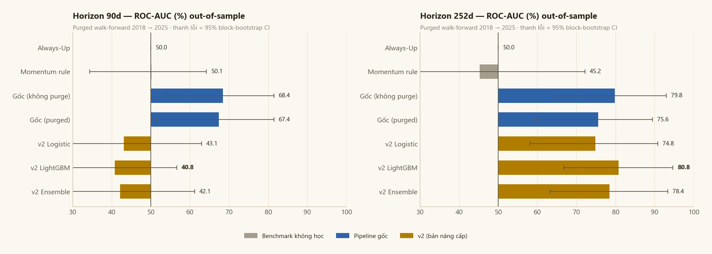
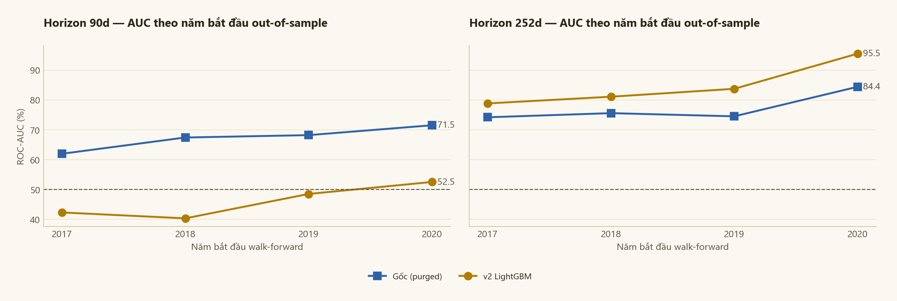
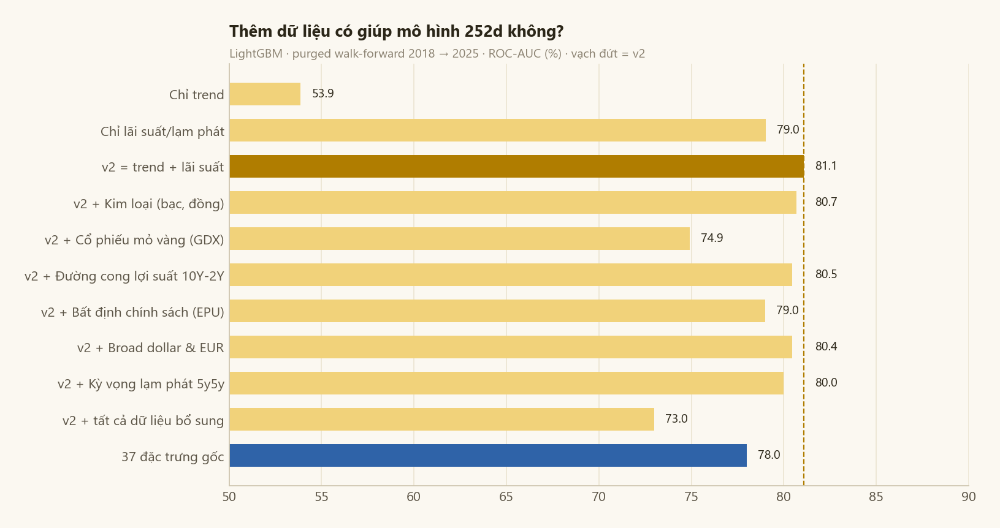
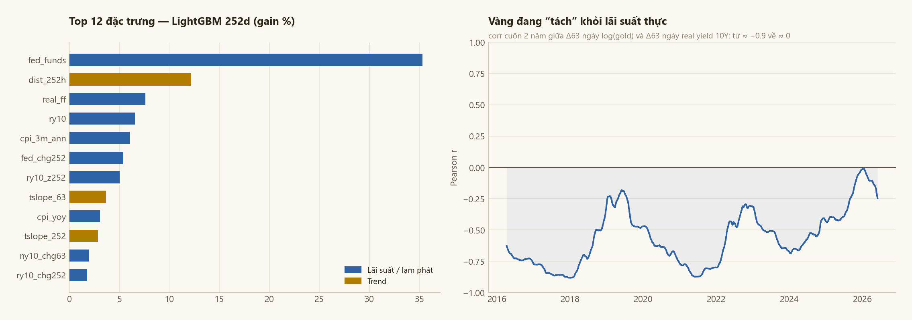
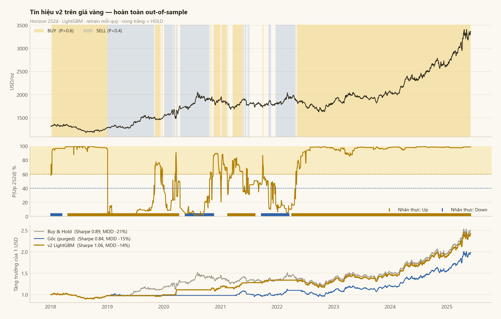

# Gold Price Trend Prediction

Đồ án môn Học máy thống kê (UIT), nhóm 22. Mục tiêu là dự đoán xu hướng giá vàng trong 90 ngày và 252 ngày (khoảng 1 năm giao dịch) tới, dùng dữ liệu thị trường và vĩ mô từ Yahoo Finance và FRED.


Repo gồm hai phần. Phần đầu (notebook 01 đến 03) là pipeline gốc đúng như trong báo cáo. Phần sau (notebook 04) là bản nâng cấp: mình kiểm tra lại pipeline gốc, phát hiện vài chỗ làm kết quả bị đẹp hơn thực tế, sửa lại rồi xây mô hình mới và đánh giá trên khoảng thời gian dài hơn.

Kết quả ngắn gọn: con số AUC 99.7% ở horizon 252 ngày trong báo cáo gốc không phản ánh khả năng dự đoán thật. Khi đánh giá lại cho đúng trên giai đoạn 2018 - 2025, pipeline gốc còn AUC 75.6%, bản v2 đạt 80.8% và tốt hơn bản gốc ở mọi năm bắt đầu mình thử. Riêng horizon 90 ngày thì chưa mô hình nào dự đoán ổn định được.

## Bài toán

Với mỗi ngày t, mình fit một đường hồi quy tuyến tính lên log giá vàng của h ngày tiếp theo (h = 90 hoặc 252). Nếu độ dốc lớn hơn một ngưỡng nhỏ thì gán nhãn Uptrend, nhỏ hơn âm ngưỡng thì Downtrend, còn lại là đi ngang và bỏ khỏi tập huấn luyện. Ngưỡng là 0.00015 cho 90 ngày và 0.0001 cho 252 ngày. Cách gán nhãn này nhìn cả diễn biến giá trong cửa sổ chứ không chỉ so điểm đầu với điểm cuối.

## Dữ liệu

Dữ liệu chạy từ 02/01/2014 đến 02/06/2026, tổng cộng 3121 phiên giao dịch.

- Yahoo Finance: giá vàng tương lai (GC=F), DXY, S&P 500, dầu WTI, VIX, tỷ giá USD/VND.
- FRED, theo tháng: lãi suất Fed Funds, CPI.
- FRED, theo ngày (dùng cho v2): lãi suất thực 10 năm từ trái phiếu TIPS (DFII10), lạm phát kỳ vọng 10 năm (T10YIE), lợi suất trái phiếu 10 năm (DGS10).
- Một số chuỗi khác mình tải về để thử nhưng không giữ lại trong mô hình cuối: giá bạc, đồng, cổ phiếu mỏ vàng GDX, EUR/USD, chênh lệch lợi suất 10 năm - 2 năm, broad dollar index, chỉ số bất định chính sách EPU, lạm phát kỳ vọng 5y5y.

## Cấu trúc thư mục

```
notebooks/
    01_data_collection.ipynb     tải và ghép dữ liệu
    02_eda_preprocessing.ipynb   EDA, tiền xử lý, gán nhãn, tạo 37 đặc trưng
    03_modeling_baseline.ipynb   các mô hình của bản gốc
    04_upgrade_v2.ipynb          kiểm tra lại bản gốc và bản nâng cấp
src/
    style.py                     màu và style biểu đồ
    validation.py                walk-forward, metric, bootstrap, backtest
data/
    raw/                         dữ liệu gốc đã tải
    processed/                   dữ liệu sau xử lý (notebook 02 tạo ra)
reports/
    Gold_Price_Trend_Prediction.pdf / .docx   báo cáo
    Nhom22_Slides.pptx                        slide
    figures/                                  hình dùng trong README
```

## Pipeline gốc

Notebook 01 tải dữ liệu thị trường theo ngày và dữ liệu vĩ mô theo tháng, rồi ghép lại bằng `merge_asof`.

Notebook 02 làm EDA trên tập train (trước 2022): kiểm tra giá trị thiếu, lỗi đơn vị của USD/VND, độ lệch phân phối, kiểm định ADF, ACF/PACF, outlier, tương quan và tương quan động giữa vàng với các tài sản khác. Sau đó tiền xử lý (forward-fill, sửa đơn vị, cắt outlier theo IQR×3), gán nhãn và tạo 37 đặc trưng gồm return, volatility, chỉ báo kỹ thuật, tương quan động, vĩ mô và mùa vụ.

Notebook 03 chia train trước 2022, test từ 2022. ExtraTrees chọn 20 đặc trưng, sau đó huấn luyện Logistic Regression, Random Forest, XGBoost và LightGBM (hai mô hình sau tối ưu bằng Optuna), cộng thêm ba cách ensemble là soft voting, weighted voting và stacking. Cuối cùng có walk-forward retrain mỗi 63 ngày và phân tích lỗi.

Kết quả trên tập test 2022+ như trong báo cáo:

| Mô hình | AUC 90d | Accuracy 90d | AUC 252d | Accuracy 252d |
|---|---|---|---|---|
| Logistic Regression | 68.1 | 76.2 | 99.7 | 97.8 |
| Random Forest | 71.4 | 78.6 | 97.3 | 94.1 |
| XGBoost | 73.0 | 72.9 | 96.7 | 93.4 |
| LightGBM | 70.5 | 76.1 | 98.4 | 97.4 |
| Soft Voting | 76.9 | 78.0 | 98.3 | 97.3 |
| Weighted Voting | 76.6 | 78.0 | 98.3 | 97.3 |
| Stacking | 56.4 | 72.3 | 4.1 | 91.0 |
| Walk-forward (XGBoost) | 70.3 | 65.4 | 79.3 | 72.7 |

Output của notebook 03 được giữ nguyên từ lần chạy gốc. Khi chạy lại với scikit-learn 1.6.1 thì Logistic Regression và Random Forest ra đúng từng chữ số. XGBoost và LightGBM đi qua Optuna nên có thể lệch một chút tùy phiên bản thư viện.

## Kiểm tra lại pipeline gốc

Con số 99.7% trông quá tốt nên mình kiểm tra lại, và tìm ra mấy vấn đề sau.


Thứ nhất, tập test gần như chỉ có một lớp. Ở horizon 252 ngày, 93.8% mẫu test là Uptrend và nhãn chỉ đổi đúng một lần (giảm từ tháng 1 đến tháng 3/2022, sau đó tăng liên tục). Chỉ cần luôn đoán Up là đã có accuracy 93.8%. AUC 99.7% thực chất chỉ là mô hình tách được ba tháng đầu năm 2022 ra khỏi phần còn lại. Ở 90 ngày cũng tương tự: 75.6% là Up, nhãn đổi 4 lần.

Thứ hai, nhãn bị rò rỉ qua ranh giới train/test. Nhãn của một ngày cuối năm 2021 được tính từ giá của 252 ngày sau đó, tức là giá năm 2022. Có 194 mẫu train như vậy ở horizon 252 ngày. Walk-forward trong bản gốc cũng không loại bỏ các mẫu này, và việc chọn đặc trưng lẫn tối ưu tham số đều làm một lần trên toàn bộ dữ liệu 2014 - 2021 rồi dùng lại cho các fold bắt đầu từ 2016.

Thứ ba, đặc trưng `real_rate` thực ra không phải lãi suất thực. Nó được tính bằng `fed_funds - cpi.pct_change()`, nhưng CPI là số liệu tháng được kéo ra theo ngày nên `pct_change()` bằng 0 ở 95.3% số ngày. Kết quả là `real_rate` tương quan 0.9991 với `fed_funds`. Tương tự, `cpi_yoy` dùng `pct_change(12)` nên là thay đổi qua 12 phiên chứ không phải 12 tháng.

Thứ tư, dữ liệu vĩ mô được dùng trước khi công bố. Ví dụ CPI tháng 7/2022 có trong dữ liệu từ ngày 1/7 trong khi đến 10/8 mới được công bố. Fed Funds là số trung bình cả tháng nhưng cũng được gán từ ngày đầu tháng.

## Bản nâng cấp v2

Mình giữ nguyên mục tiêu và cách gán nhãn, chỉ thay đổi những chỗ sau.

Dữ liệu vĩ mô được gán theo ngày công bố: Fed Funds lùi một tháng, CPI lùi khoảng 45 ngày, số liệu FRED theo ngày lùi một ngày. CPI YoY tính đúng trên 12 tháng.

Bộ đặc trưng còn 26 thay vì 37, chia làm hai nhóm. Nhóm trend có độ dốc giá trong 21, 63, 126 và 252 ngày qua (cùng kiểu tính với nhãn nhưng nhìn về quá khứ), momentum, tỉ lệ MA50/MA200, khoảng cách tới đỉnh và đáy 52 tuần. Nhóm lãi suất gồm lãi suất thực TIPS 10 năm, lạm phát kỳ vọng, lợi suất 10 năm, Fed Funds, CPI YoY và lãi suất thực tính từ Fed Funds trừ CPI.


Cách đánh giá là walk-forward từ 2018 đến 2025, mỗi quý train lại một lần, bỏ đi các mẫu train có nhãn chồng lên giai đoạn test. Mọi bước như chuẩn hóa hay chọn đặc trưng đều nằm trong từng lần train. Ngoài AUC, mình báo thêm balanced accuracy và MCC vì dữ liệu lệch lớp nặng, so với hai mốc đơn giản là luôn đoán Up và đoán theo xu hướng quá khứ, và tính khoảng tin cậy 95% bằng block bootstrap.

Pipeline gốc cũng được chạy lại với đúng cách đánh giá này để so sánh công bằng: một lần có loại bỏ mẫu chồng nhãn, một lần không.

## Kết quả



Horizon 252 ngày, 1707 mẫu có nhãn, 82.5% là Up:

| Mô hình | AUC | Khoảng tin cậy 95% | Balanced Acc | Accuracy | MCC |
|---|---|---|---|---|---|
| Luôn đoán Up | 50.0 | | 50.0 | 82.5 | 0.00 |
| Theo xu hướng quá khứ | 45.2 | 18.1 - 72.2 | 48.5 | 63.9 | -0.03 |
| Bản gốc, không loại mẫu chồng nhãn | 79.8 | 64.5 - 92.9 | 66.2 | 73.8 | 0.28 |
| Bản gốc, có loại | 75.6 | 59.7 - 89.4 | 60.7 | 70.9 | 0.18 |
| v2 Logistic Regression | 74.8 | 58.0 - 90.8 | 68.3 | 74.3 | 0.31 |
| v2 LightGBM | 80.8 | 66.8 - 94.6 | 73.6 | 75.0 | 0.38 |
| v2 trung bình LR và LightGBM | 78.4 | 63.3 - 93.3 | 72.4 | 75.2 | 0.37 |

Chỉ riêng việc loại các mẫu chồng nhãn đã làm AUC của bản gốc giảm từ 79.8 xuống 75.6. v2 LightGBM đạt AUC 80.8 và balanced accuracy 73.6, cao hơn bản gốc 13 điểm.

Khoảng tin cậy còn rộng vì nhãn 252 ngày của các ngày gần nhau gần như trùng nhau, nên 7 năm dữ liệu chỉ tương đương khoảng 7 quan sát độc lập. Vì vậy mình thử đổi năm bắt đầu walk-forward từ 2017 đến 2020. Ở cả bốn trường hợp v2 đều hơn bản gốc, balanced accuracy cao hơn từ 11 đến 16 điểm.



Ở horizon 90 ngày thì khác. Bản gốc sau khi sửa vẫn có AUC khoảng 67 nhưng balanced accuracy chỉ 56 và cận dưới khoảng tin cậy gần chạm 50. Các đặc trưng của v2 cho AUC dưới 50: quan hệ học được từ dữ liệu cũ bị đảo ngược khi áp dụng cho giai đoạn sau. Mình không xem mô hình 90 ngày nào ở đây là dùng được.

## Thử thêm dữ liệu

Mình thử thêm từng nhóm dữ liệu bổ sung vào v2 xem có cải thiện không.



Nhóm lãi suất và lạm phát đứng một mình đã đạt AUC 79.0, thêm nhóm trend lên 81.1. Không nhóm dữ liệu bổ sung nào làm kết quả tốt hơn, gộp hết vào còn giảm xuống 73.0. Nên mô hình cuối chỉ dùng hai nhóm trend và lãi suất. Với cùng LightGBM, 26 đặc trưng của v2 cũng tốt hơn 37 đặc trưng gốc (81.1 so với 78.0).

## Mô hình dựa vào gì



Nhóm lãi suất và lạm phát chiếm khoảng 76% độ quan trọng. Đặc trưng quan trọng nhất là mức lãi suất Fed Funds, sau đó là khoảng cách giá tới đỉnh 52 tuần.

Có một điểm thú vị: tương quan giữa vàng và lãi suất thực yếu dần theo thời gian, từ khoảng -0.9 vào năm 2018 và 2021 xuống còn khoảng -0.25 ở cuối dữ liệu, có lúc gần bằng 0 vào đầu năm 2026. Từ 2022 lãi suất thực tăng từ -1% lên +2% mà vàng vẫn lên đỉnh mới. Đây cũng là lý do cần train lại mô hình theo thời gian thay vì train một lần trên dữ liệu trước 2022.

## Tín hiệu mua bán và backtest

Mình dùng xác suất của v2 ở horizon 252 ngày để tạo tín hiệu: trên 0.6 thì mua, dưới 0.4 thì bán, ở giữa thì giữ nguyên. Backtest giai đoạn 2018 - 2025, tính phí 5 bps mỗi lần giao dịch.



| Chiến lược | CAGR | Biến động | Sharpe | Sụt giảm tối đa | Thời gian nắm vàng | Số giao dịch |
|---|---|---|---|---|---|---|
| Mua và giữ | 13.4% | 15.4% | 0.89 | -20.9% | 100% | 0 |
| Bản gốc | 9.8% | 12.0% | 0.84 | -15.4% | 69% | 10 |
| v2 LightGBM | 12.9% | 12.1% | 1.06 | -13.7% | 66% | 18 |

v2 giữ được gần hết lợi nhuận của việc mua và giữ trong khi chỉ nắm vàng 66% thời gian. Xem theo từng đợt vàng giảm trên 10%: năm 2018 v2 vẫn đang mua nên lỗ y như mua và giữ (-13.7%). Đợt giảm tháng 3/2020 v2 chỉ mất 0.6% so với 11.8%. Đợt giảm kéo dài từ 8/2020 đến 9/2022 v2 còn lãi 4.9% trong khi mua và giữ lỗ 20.9%. Phần lớn lợi thế đến từ đợt này.

## Kết luận

Với horizon 252 ngày, sau khi bỏ hết các chỗ rò rỉ thông tin, mô hình vẫn dự đoán được xu hướng: AUC 80.8%, balanced accuracy 73.6%, ổn định khi đổi năm bắt đầu, và giúp chiến lược đơn giản có Sharpe cao hơn, sụt giảm thấp hơn so với mua và giữ.

Với horizon 90 ngày, dữ liệu hiện có chưa đủ để dự đoán ổn định.

Vẫn còn vài hạn chế. Số quan sát độc lập ở 252 ngày ít nên khoảng tin cậy rộng. Dữ liệu FRED tải về là bản đã điều chỉnh, không phải số công bố lần đầu. Backtest chưa tính trượt giá và thuế. Hướng tiếp theo có thể là thêm dữ liệu mua vàng của ngân hàng trung ương và dòng tiền vào quỹ ETF vàng, hai yếu tố có thể giải thích vì sao vàng tách khỏi lãi suất thực từ 2022.

## Cách chạy

```bash
git clone https://github.com/NamPhuong550805/Gold-Price-Trend-Prediction.git
cd Gold-Price-Trend-Prediction
pip install -r requirements.txt
jupyter lab notebooks/
```

Dữ liệu đã có sẵn trong `data/raw/` nên có thể bỏ qua notebook 01 (chạy lại sẽ tải dữ liệu mới nhất và kết quả sẽ khác). Chạy notebook 02 để tạo `data/processed/`, sau đó chạy 03 và 04. Notebook 04 mất khoảng 4 - 6 phút.

## Báo cáo

Báo cáo đầy đủ ở [reports/Gold_Price_Trend_Prediction.pdf](reports/Gold_Price_Trend_Prediction.pdf), slide ở [reports/Nhom22_Slides.pptx](reports/Nhom22_Slides.pptx).

Nguyễn Phương Nam (23520980), Trường Đại học Công nghệ Thông tin, ĐHQG TP.HCM.
