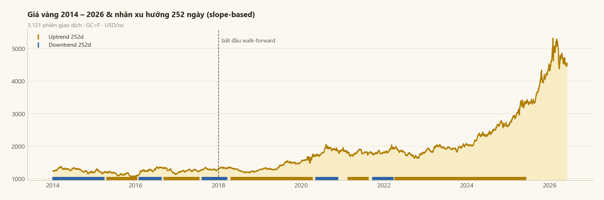
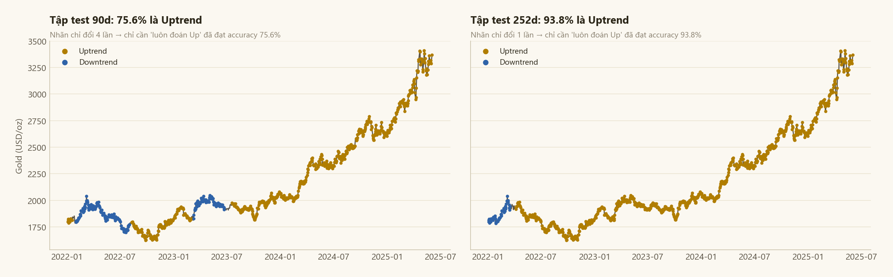
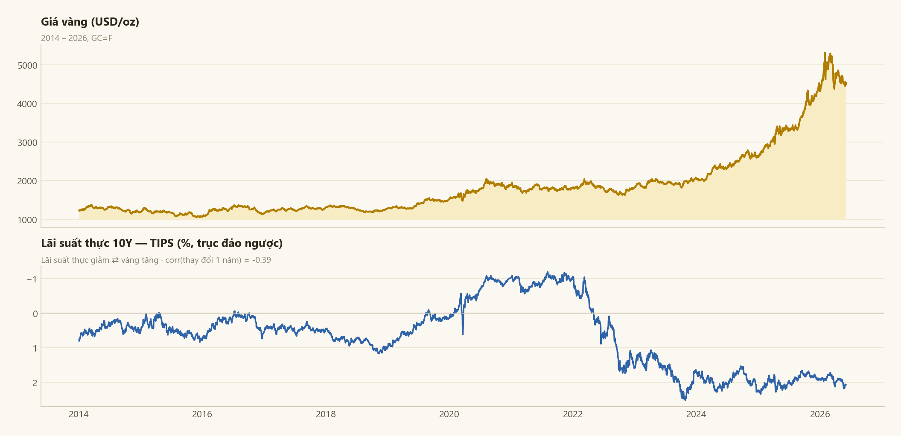
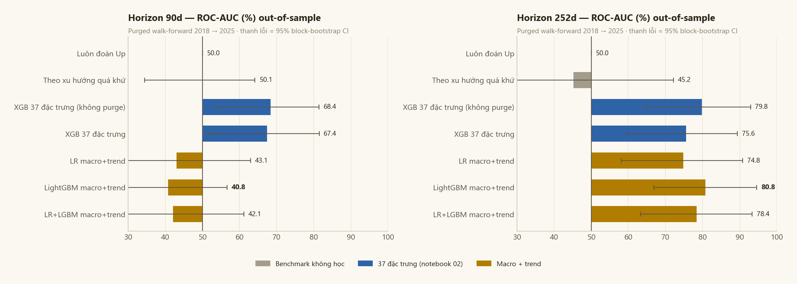
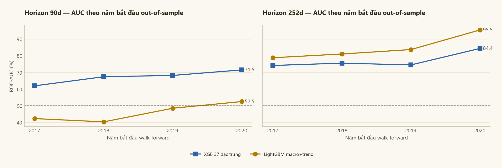
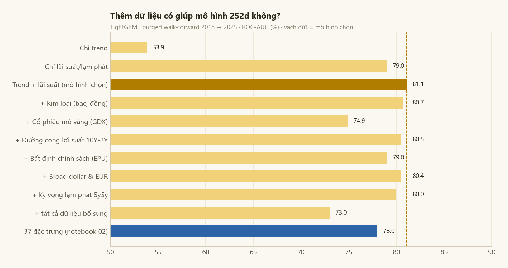
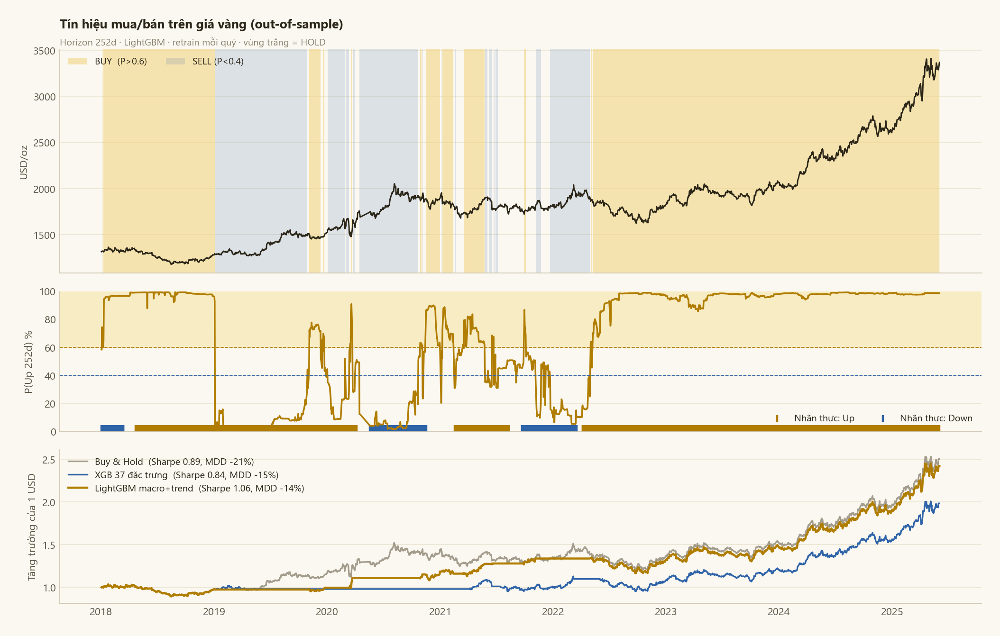

# Gold Price Trend Prediction

Đồ án môn Học máy thống kê, Trường Đại học Công nghệ Thông tin (UIT).

Project dự đoán xu hướng giá vàng trong 90 ngày và 252 ngày (khoảng 1 năm giao dịch) tới, dùng dữ liệu thị trường từ Yahoo Finance và dữ liệu vĩ mô từ FRED. Mô hình cuối cùng là LightGBM trên một bộ đặc trưng gồm xu hướng giá và lãi suất thực. Khi đánh giá walk-forward trên giai đoạn 2018 - 2025, mô hình này đạt AUC 80.8% và balanced accuracy 73.6% ở horizon 252 ngày.



## Bài toán

Với mỗi ngày t, fit một đường hồi quy tuyến tính lên log giá vàng của h ngày tiếp theo (h = 90 hoặc 252). Nếu độ dốc lớn hơn một ngưỡng nhỏ thì gán nhãn Uptrend, nhỏ hơn âm ngưỡng thì Downtrend, còn lại là đi ngang và bỏ khỏi tập huấn luyện. Ngưỡng là 0.00015 cho 90 ngày và 0.0001 cho 252 ngày. Cách gán nhãn này nhìn cả diễn biến giá trong cửa sổ chứ không chỉ so điểm đầu với điểm cuối.

## Dữ liệu

Dữ liệu chạy từ 02/01/2014 đến 02/06/2026, tổng cộng 3121 phiên giao dịch.

- Yahoo Finance: giá vàng tương lai (GC=F), DXY, S&P 500, dầu WTI, VIX, tỷ giá USD/VND.
- FRED theo tháng: lãi suất Fed Funds, CPI.
- FRED theo ngày: lãi suất thực 10 năm từ trái phiếu TIPS (DFII10), lạm phát kỳ vọng 10 năm (T10YIE), lợi suất trái phiếu 10 năm (DGS10).
- Một số chuỗi khác tải về để thử: giá bạc, đồng, cổ phiếu mỏ vàng GDX, EUR/USD, chênh lệch lợi suất 10 năm - 2 năm, broad dollar index, chỉ số bất định chính sách EPU, lạm phát kỳ vọng 5y5y.

## Pipeline

1. Thu thập dữ liệu từ Yahoo Finance và FRED, ghép theo ngày giao dịch (notebook 01).
2. EDA trên giai đoạn trước 2022: giá trị thiếu, lỗi đơn vị, phân phối, kiểm định tính dừng ADF, ACF/PACF, outlier, tương quan và tương quan động giữa vàng với các tài sản khác (notebook 02).
3. Tiền xử lý, gán nhãn và tạo bộ 37 đặc trưng gồm return, volatility, chỉ báo kỹ thuật, tương quan động, vĩ mô và mùa vụ (notebook 02).
4. Huấn luyện và so sánh Logistic Regression, Random Forest, XGBoost, LightGBM và ba cách ensemble trên split theo thời gian, train trước 2022 và test từ 2022 (notebook 03).
5. Chuyển sang đánh giá walk-forward 2018 - 2025, train lại mỗi quý và loại các mẫu train có nhãn chồng lên giai đoạn test (notebook 04).
6. Xây bộ đặc trưng thứ hai gồm 26 biến về xu hướng giá và lãi suất thực, với dữ liệu vĩ mô gán theo ngày công bố. So sánh với bộ 37 đặc trưng, thử thêm dữ liệu, chọn mô hình cuối (notebook 04).
7. Phân tích mô hình dựa vào đặc trưng nào, tạo tín hiệu mua/bán và backtest (notebook 04).

## Cấu trúc thư mục

```
notebooks/
    01_data_collection.ipynb           tải và ghép dữ liệu
    02_eda_preprocessing.ipynb         EDA, tiền xử lý, gán nhãn, tạo 37 đặc trưng
    03_model_training.ipynb            huấn luyện các mô hình trên split theo thời gian
    04_walk_forward_evaluation.ipynb   walk-forward, mô hình cuối, phân tích, backtest
src/
    style.py                           màu và style biểu đồ
    validation.py                      walk-forward, metric, bootstrap, backtest
data/
    raw/                               dữ liệu đã tải
    processed/                         dữ liệu sau xử lý (notebook 02 tạo ra)
results/
    figures/                           biểu đồ
    walk_forward_metrics.csv           bảng kết quả walk-forward
```

## Một số điểm từ EDA

Giá vàng, DXY, S&P 500, Fed Funds và CPI đều không dừng ở dạng level (ADF p > 0.05), nên đặc trưng được xây trên return, chênh lệch hoặc tỉ lệ. VIX lệch phải rất mạnh (skew 3.1) nên dùng log. Return của vàng gần như không có tự tương quan nhưng bình phương return thì có, tức là có hiện tượng volatility clustering. Tương quan giữa vàng và các tài sản khác đổi dấu nhiều lần theo thời gian, nên có thêm các đặc trưng tương quan động 20 và 60 ngày. Cột USD/VND có một số dòng bị sai đơn vị (khoảng 21 thay vì 21000) và được sửa trong bước tiền xử lý.

## Huấn luyện trên split theo thời gian

Train trước 2022, test từ 2022. ExtraTrees chọn 20 trong 37 đặc trưng. XGBoost và LightGBM được tối ưu bằng Optuna (60 trials, TimeSeriesSplit 5 fold).

| Mô hình | AUC 90d | Accuracy 90d | AUC 252d | Accuracy 252d |
|---|---|---|---|---|
| Logistic Regression | 68.1 | 76.2 | 99.7 | 97.8 |
| Random Forest | 71.4 | 78.6 | 97.3 | 94.1 |
| XGBoost | 73.0 | 72.9 | 96.7 | 93.4 |
| LightGBM | 70.5 | 76.1 | 98.4 | 97.4 |
| Soft Voting | 76.9 | 78.0 | 98.3 | 97.3 |
| Weighted Voting | 76.6 | 78.0 | 98.3 | 97.3 |
| Stacking | 56.4 | 72.3 | 4.1 | 91.0 |

Kết quả ở horizon 252 ngày trông rất cao, nhưng nhìn vào tập test thì thấy vấn đề.



Ở 252 ngày, 93.8% mẫu test là Uptrend và nhãn chỉ đổi đúng một lần (giảm từ tháng 1 đến tháng 3/2022, sau đó tăng liên tục). Chỉ cần luôn đoán Up là đã có accuracy 93.8%, nên AUC 99.7% chỉ cho biết mô hình tách được ba tháng đầu 2022 ra khỏi phần còn lại. Ở 90 ngày, 75.6% là Up và nhãn đổi 4 lần.

Ngoài ra, nhãn của những ngày cuối 2021 được tính từ giá năm 2022, tức là 194 mẫu train (ở 252 ngày) đã chứa thông tin của giai đoạn test. Vì vậy phần đánh giá chính dùng walk-forward trên một giai đoạn dài hơn.

## Đánh giá walk-forward

Bắt đầu từ 2018, mỗi quý train lại trên toàn bộ dữ liệu trước đó và dự đoán quý tiếp theo, kéo dài đến giữa 2025. Các mẫu train có cửa sổ nhãn chồng lên quý đang dự đoán bị loại ra. Mọi bước như chuẩn hóa hay chọn đặc trưng đều làm lại trong từng lần train. Ngoài AUC còn có balanced accuracy và MCC vì dữ liệu lệch lớp nặng, hai mốc so sánh đơn giản (luôn đoán Up, đoán theo xu hướng quá khứ) và khoảng tin cậy 95% bằng block bootstrap.

Bộ 37 đặc trưng có một điểm yếu ở phần vĩ mô. `real_rate` được tính bằng `fed_funds - cpi.pct_change()`, nhưng CPI là số liệu tháng được kéo ra theo ngày nên `pct_change()` bằng 0 ở 95.3% số ngày và `real_rate` gần như trùng với `fed_funds` (tương quan 0.999). CPI và Fed Funds cũng được gán từ đầu tháng, trong khi thực tế CPI tháng 7/2022 đến 10/8 mới công bố.

Vì vậy bộ đặc trưng thứ hai dùng lãi suất thực lấy trực tiếp từ trái phiếu TIPS, và mọi số liệu vĩ mô được gán theo ngày công bố: Fed Funds lùi một tháng, CPI lùi khoảng 45 ngày, số liệu FRED theo ngày lùi một ngày. Bộ này có 26 biến chia làm hai nhóm. Nhóm trend có độ dốc giá trong 21, 63, 126 và 252 ngày qua, momentum, tỉ lệ MA50/MA200, khoảng cách tới đỉnh và đáy 52 tuần. Nhóm lãi suất gồm lãi suất thực 10 năm, lạm phát kỳ vọng, lợi suất 10 năm, Fed Funds, CPI so với cùng kỳ và chênh lệch Fed Funds với CPI.



Kết quả walk-forward của hai bộ đặc trưng:



Chi tiết ở horizon 252 ngày (1707 mẫu có nhãn, 82.5% là Up):

| Mô hình | AUC | Khoảng tin cậy 95% | Balanced Acc | Accuracy | MCC |
|---|---|---|---|---|---|
| Luôn đoán Up | 50.0 | | 50.0 | 82.5 | 0.00 |
| Theo xu hướng quá khứ | 45.2 | 18.1 - 72.2 | 48.5 | 63.9 | -0.03 |
| XGBoost, 37 đặc trưng, không loại mẫu chồng nhãn | 79.8 | 64.5 - 92.9 | 66.2 | 73.8 | 0.28 |
| XGBoost, 37 đặc trưng | 75.6 | 59.7 - 89.4 | 60.7 | 70.9 | 0.18 |
| Logistic Regression, macro + trend | 74.8 | 58.0 - 90.8 | 68.3 | 74.3 | 0.31 |
| LightGBM, macro + trend | 80.8 | 66.8 - 94.6 | 73.6 | 75.0 | 0.38 |
| LR + LightGBM, macro + trend | 78.4 | 63.3 - 93.3 | 72.4 | 75.2 | 0.37 |

Nếu không loại các mẫu chồng nhãn, AUC của XGBoost trên 37 đặc trưng là 79.8. Loại đi thì còn 75.6, cho thấy phần chênh lệch đến từ rò rỉ thông tin. LightGBM trên bộ macro + trend đạt AUC 80.8 và balanced accuracy 73.6, cao hơn 13 điểm so với bộ 37 đặc trưng. Đây là mô hình được chọn.

Khoảng tin cậy còn rộng vì nhãn 252 ngày của các ngày gần nhau gần như trùng nhau, nên 7 năm dữ liệu chỉ tương đương khoảng 7 quan sát độc lập. Để chắc hơn, thử đổi năm bắt đầu walk-forward từ 2017 đến 2020. Cả bốn lần bộ macro + trend đều tốt hơn, balanced accuracy cao hơn từ 11 đến 16 điểm.



Ở horizon 90 ngày thì khác. XGBoost trên 37 đặc trưng có AUC khoảng 67 nhưng balanced accuracy chỉ 56 và cận dưới khoảng tin cậy gần chạm 50. Bộ macro + trend cho AUC dưới 50: quan hệ học được từ dữ liệu cũ bị đảo ngược ở giai đoạn sau. Với dữ liệu hiện có, chưa có mô hình 90 ngày nào đủ ổn định để dùng.

## Thử thêm dữ liệu

Thêm lần lượt từng nhóm dữ liệu bổ sung vào bộ macro + trend để xem có cải thiện không.



Nhóm lãi suất và lạm phát đứng một mình đã đạt AUC 79.0, thêm nhóm trend lên 81.1. Không nhóm dữ liệu bổ sung nào làm kết quả tốt hơn, gộp hết vào còn giảm xuống 73.0. Nên mô hình cuối chỉ giữ hai nhóm trend và lãi suất.

## Mô hình dựa vào gì


Nhóm lãi suất và lạm phát chiếm khoảng 76% độ quan trọng. Đặc trưng quan trọng nhất là mức lãi suất Fed Funds, sau đó là khoảng cách giá tới đỉnh 52 tuần.

Tương quan giữa vàng và lãi suất thực yếu dần theo thời gian, từ khoảng -0.9 vào năm 2018 và 2021 xuống còn khoảng -0.25 ở cuối dữ liệu, có lúc gần bằng 0 vào đầu năm 2026. Từ 2022 lãi suất thực tăng từ -1% lên +2% mà vàng vẫn lên đỉnh mới. Đây cũng là lý do cần train lại mô hình theo thời gian thay vì train một lần.

## Tín hiệu mua bán và backtest

Xác suất dự đoán ở horizon 252 ngày được chuyển thành tín hiệu: trên 0.6 thì mua, dưới 0.4 thì bán, ở giữa thì giữ nguyên. Backtest giai đoạn 2018 - 2025, tính phí 5 bps mỗi lần giao dịch.



| Chiến lược | CAGR | Biến động | Sharpe | Sụt giảm tối đa | Thời gian nắm vàng | Số giao dịch |
|---|---|---|---|---|---|---|
| Mua và giữ | 13.4% | 15.4% | 0.89 | -20.9% | 100% | 0 |
| XGBoost, 37 đặc trưng | 9.8% | 12.0% | 0.84 | -15.4% | 69% | 10 |
| LightGBM, macro + trend | 12.9% | 12.1% | 1.06 | -13.7% | 66% | 18 |

Chiến lược theo mô hình giữ được gần hết lợi nhuận của việc mua và giữ trong khi chỉ nắm vàng 66% thời gian. Xem theo từng đợt vàng giảm trên 10%: năm 2018 mô hình vẫn đang mua nên lỗ y như mua và giữ (-13.7%). Đợt giảm tháng 3/2020 chỉ mất 0.6% so với 11.8%. Đợt giảm kéo dài từ 8/2020 đến 9/2022 còn lãi 4.9% trong khi mua và giữ lỗ 20.9%, phần lớn lợi thế đến từ đợt này.

## Kết luận

Với horizon 252 ngày, mô hình LightGBM trên bộ đặc trưng xu hướng giá và lãi suất thực dự đoán được xu hướng vàng khá tốt: AUC 80.8%, balanced accuracy 73.6%, ổn định khi đổi năm bắt đầu, và giúp một chiến lược đơn giản có Sharpe cao hơn, sụt giảm thấp hơn so với mua và giữ. Với horizon 90 ngày, dữ liệu hiện có chưa đủ để dự đoán ổn định.

Một số hạn chế: số quan sát độc lập ở 252 ngày ít nên khoảng tin cậy rộng, dữ liệu FRED tải về là bản đã điều chỉnh chứ không phải số công bố lần đầu, và backtest chưa tính trượt giá hay thuế. Hướng tiếp theo có thể là thêm dữ liệu mua vàng của các ngân hàng trung ương và dòng tiền vào quỹ ETF vàng, hai yếu tố có thể giải thích vì sao vàng tách khỏi lãi suất thực từ 2022.

## Cách chạy

```bash
git clone https://github.com/NamPhuong550805/Gold-Price-Trend-Prediction.git
cd Gold-Price-Trend-Prediction
pip install -r requirements.txt
jupyter lab notebooks/
```

Dữ liệu đã có sẵn trong `data/raw/` nên có thể bỏ qua notebook 01 (chạy lại sẽ tải dữ liệu mới nhất và kết quả sẽ khác). Chạy notebook 02 để tạo `data/processed/`, sau đó chạy 03 và 04. Notebook 04 mất khoảng 4 - 6 phút.

Output của notebook 03 là từ lần chạy đầu tiên. Logistic Regression và Random Forest cho ra đúng các con số này với scikit-learn 1.6.1. XGBoost và LightGBM đi qua Optuna nên có thể lệch một chút tùy phiên bản thư viện.
